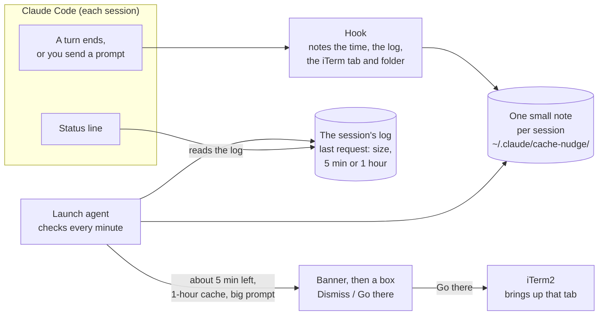

import Tabs from '@theme/Tabs';
import TabItem from '@theme/TabItem';

## What I observed

Do you keep a lot of Claude Code sessions open at once? Then this one is for you.

After I moved my main conversations to the
[1-hour prompt cache](/craft/generative-ai/claude-code-techniques/picking-the-prompt-cache-time-limit),
I kept losing it anyway. I'd step into a meeting, come back 70 minutes later, and the first thing I
typed would pay to write the whole conversation into the cache again. On a big session that one
request costs more than the rest of the afternoon.

The hour was long enough. I just didn't know which of my 12 to 16 sessions was about to run out.

## Explained simply

- Claude Code keeps your conversation in a **prompt cache** so it doesn't pay full price to send it
  again on every turn.
- With the 1-hour setting, that cache lasts **an hour after your last request**. Each new request
  starts the hour again.
- Miss the hour, and the next request **writes the whole prompt again at twice the normal input
  price**. Come back in time and it's read back at a small fraction of it.
- So the cheapest thing you can do before a long break is **send the session anything** a few
  minutes before the hour is up. Even "ok, carry on" keeps it.

The helper on this page only tells you when. It never types for you.

## What I did about it

I asked Claude to build a reminder that watches my sessions and taps me on the shoulder before the
hour runs out, with a way to jump straight to the right iTerm tab. Then I asked for the same clock in
the status line, so I could see it without waiting for a pop-up.

## What it looks like

<figure style={{maxWidth: '960px', margin: '0 auto 1.5rem'}}>
  
  <figcaption>Of three open sessions, only my-app is about to run out, so that's the one the reminder names.</figcaption>
</figure>

1. **The banner.** It lands in Notification Center, so it's still there if you were away when it
   showed.
2. **The box.** Same message, plus where the session lives. **Go there** brings up that iTerm tab.
   **Dismiss** closes it. It goes away by itself after two minutes.
3. **The status line.** Every session shows when its cache runs out, as a clock time.

## How it works



- **A hook** runs when a turn ends, when you send a prompt and when a session closes. It writes one
  small note per session: when the turn ended, where the log is, the iTerm tab's id and the folder's
  name. It prints nothing and always exits cleanly, so it can never hold up Claude.
- **A launch agent** runs a check every minute. For each session that has been quiet for about 54
  minutes, it reads the last request in the session's log: how big the prompt was, and whether it
  was cached for 5 minutes or an hour. That comes from what the session really did, so a session on
  the 5-minute cache is left alone.
- **It reminds once per pause**, and only when it's worth it: a 1-hour cache, a prompt over 100,000
  tokens, and not between 10 pm and 8 am.
- **The banner and box** come from AppleScript. "Go there" asks iTerm2 to select the tab by the id
  the hook noted.
- **The status line** reads the same log and prints the clock time the cache runs out.

## Set it up

You need a Mac, iTerm2, and Node 20 or newer.

1. **Get the script.** *(Coming soon: the script will be published as a gist, with a one-line
   download here.)*
2. **Install it.** This copies the script into `~/.claude/hooks/`, backs up your
   `~/.claude/settings.json`, adds three hook entries to it, and loads the launch agent:

   ```bash
   node cache-nudge.mjs install
   ```

   Sessions that are already open pick up the hook only after you restart them.
3. **Try it once from an iTerm tab.** This lines up a reminder for the tab you're in, so you can see
   the box and press **Go there**:

   ```bash
   node ~/.claude/hooks/claude-cache-nudge.mjs try --transcript <this session's log>
   ```

   The first time, macOS asks whether it may control iTerm. Click **Allow**.
4. **Check it's on** whenever a reminder doesn't show:

   ```bash
   node ~/.claude/hooks/claude-cache-nudge.mjs status
   ```

### Add the clock to your status line

The status line shows a clock time, not a countdown. Claude Code only redraws the status line when
something happens in the session, so a countdown would sit frozen while you're away. The clock time
stays true.

<Tabs>
<TabItem value="script" label="You already have a status line script" default>

Add these two lines after your script reads its input into `$input`:

```bash
cache_seg=$(echo "$input" | node ~/.claude/hooks/claude-cache-nudge.mjs statusline 2>/dev/null)
[[ -n "$cache_seg" ]] && output+=" | ⏳${cache_seg}"
```

</TabItem>
<TabItem value="new" label="You don't have one yet">

Point the status line straight at the script in `~/.claude/settings.json`:

```json
{
  "statusLine": {
    "type": "command",
    "command": "node ~/.claude/hooks/claude-cache-nudge.mjs statusline"
  }
}
```

</TabItem>
</Tabs>

It prints `cache till 3:42 PM (1h)`, or `cache expired (1h)` once the hour has passed.

### Change the defaults

Put any of these in `~/.claude/cache-nudge/config.json`:

| Setting | Default | What it does |
|---|---|---|
| `minTokens` | `100000` | Skip prompts smaller than this; they cost little to write again |
| `leadMinutes` | `5` | How many minutes before the end to remind you |
| `quietStart` / `quietEnd` | `22` / `8` | No reminders between these hours |
| `forgetHours` | `6` | Drop a session's note after this long |

To turn it all off: `node ~/.claude/hooks/claude-cache-nudge.mjs uninstall`. It removes exactly what
install added and keeps the log and the settings backups.

## Words of caution

- **It only reminds.** It never types into a tab or sends a prompt to keep a cache warm. You decide
  whether the session is worth keeping.
- **The banner shows up as "Script Editor"** in System Settings → Notifications, because that's what
  posts it. If you see the box but no banner, turn notifications on there. Clicking the banner opens
  Script Editor, so the jump to iTerm lives in the box.
- **Other tools can rewrite your settings file** and drop the hook entries. The reminders then stop
  with no error. `status` says `hooks: MISSING` when that happens; run install again.
- **It's iTerm2 only** for the jump. In another terminal you still get the banner and the box, with
  just an **OK** button.
- **Your notes and log stay on your Mac**, in `~/.claude/cache-nudge/`. They hold folder names and
  session ids, so keep them out of anything you share.

## Why it works

- **The cost of a miss is lopsided.** Keeping the cache costs one small request. Losing it costs a
  full rewrite at twice the input price.
- **The log already knows.** Every request's time, size and cache length is in the session's log, so
  nothing has to guess.
- **A reminder beats a habit.** With a dozen sessions open, you can't keep a dozen clocks in your
  head. A tap on the shoulder five minutes out is enough.

## Related

- [Tip: Ask Claude to Optimize Your Cache TTL](/craft/generative-ai/claude-code-techniques/picking-the-prompt-cache-time-limit):
  pick the 5-minute or 1-hour cache from your own breaks.
- [How Claude Code's Prompt Cache Works](/craft/generative-ai/claude-code-explainers/how-the-prompt-cache-works):
  what the cache holds, the two time limits and their prices.
- [Hooks in Claude Code](https://code.claude.com/docs/en/hooks) and
  [the status line](https://code.claude.com/docs/en/statusline).
- [Prompt caching in Claude Code](https://code.claude.com/docs/en/prompt-caching).
- [iTerm2's AppleScript support](https://iterm2.com/documentation-scripting.html).
- This page goes with a post in my "How I Used Claude Today" series on LinkedIn.
