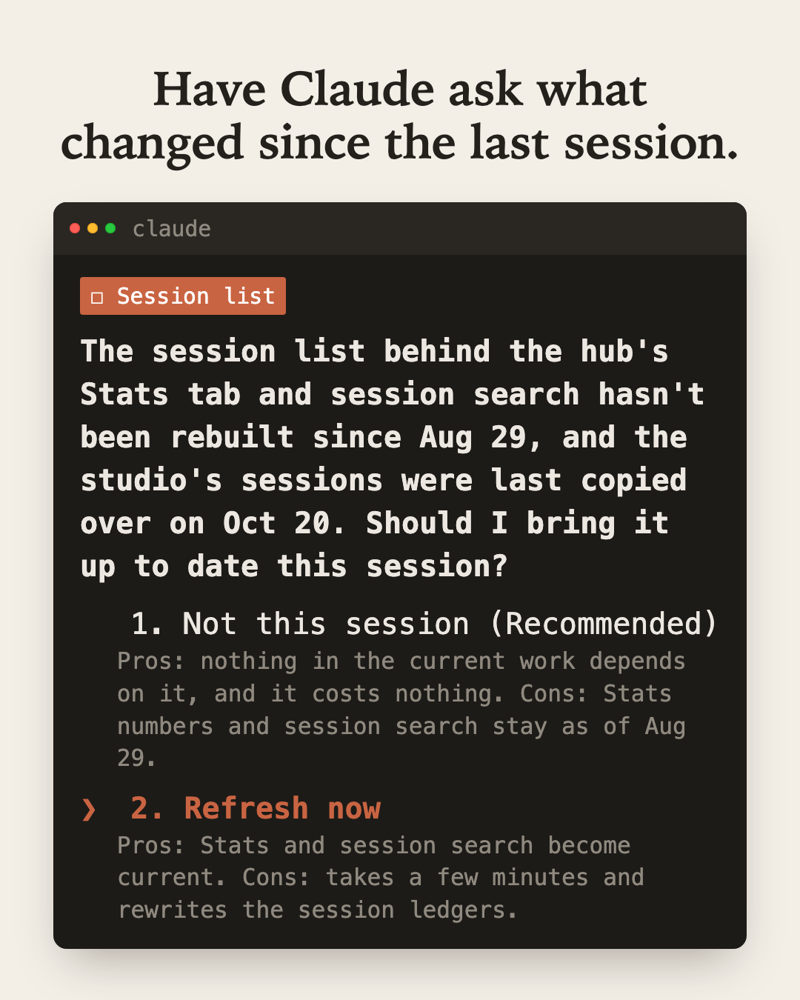

## The problem

Some repos come with housekeeping. In the one where I draft these posts, comments land on my pages
while I'm away from the terminal, the usage numbers need refreshing every so often, and sessions from my
other Mac need copying over. None of it is the work I sat down to do, so none of it is on my mind
when I type the first line.

For two months I tried to catch one of these at the other end. In that repo,
a reminder at the end of each session said the session index was stale. It was right every
time, and it never got fixed. By the time it showed, the session was done and I was moving on. The
index fell further and further behind.

## The technique

Check at the start, and ask there. A **SessionStart hook** runs when a session starts or resumes.
Whatever it prints goes into Claude's context before your first message. So the hook checks the
repo's housekeeping, and for each chore that's due, it tells Claude to ask you up front with the
question tool: do it now, or not this session.

Four kinds of chore fit here:

| Kind | Examples |
|---|---|
| **Work left while you were away** | Comments on your pages waiting for a reply, items in an inbox file, a review someone left |
| **Things to sync** | Commits on the remote, sessions on another machine |
| **Things to refresh** | Metrics or a report older than a week, an index behind the files on disk |
| **Things about to expire** | A login token, a certificate, a trial |

The question matters as much as the check. A line of text at the top of a session is easy to
scroll past. A question with two options, and what each one costs, gets an answer. "Not this
session" is a fine answer too. It's a choice you made, not a reminder you missed, and the same
question comes back next time.

## Set it up

Save this as `.claude/hooks/housekeeping.sh` in your project. Each check adds one line to `due`.
Swap in your own chores:

```bash
#!/usr/bin/env bash
# SessionStart hook: check the repo's housekeeping, and have Claude ask about what's due.
cd "$CLAUDE_PROJECT_DIR" || { echo "housekeeping: could not open the project"; exit 0; }
due=()
waiting=$(grep -c '^- ' comments.md 2>/dev/null)
[ "${waiting:-0}" -gt 0 ] && due+=("Comments left while you were away: $waiting. Answer them?")
if [ -z "$(find .metrics/last-refresh -mtime -7 2>/dev/null)" ]; then
  due+=("The metrics are more than a week old. Refresh them with make metrics?")
fi
GIT_TERMINAL_PROMPT=0 git fetch -q 2>/dev/null
behind=$(git rev-list --count HEAD..@{u} 2>/dev/null || echo 0)
[ "$behind" -gt 0 ] && due+=("Your branch is $behind commits behind the remote. Pull them?")
if [ ${#due[@]} -eq 0 ]; then echo "housekeeping: nothing due"; exit 0; fi
echo "Housekeeping due:"
printf -- '- %s\n' "${due[@]}"
echo "Before any other work, ask me about these with AskUserQuestion, one question each:"
echo "do it now, or not this session. Say what each choice costs."
```

Then register it in `.claude/settings.json`:

```json
{
  "hooks": {
    "SessionStart": [
      {
        "matcher": "startup|resume",
        "hooks": [
          { "type": "command", "command": "bash \"$CLAUDE_PROJECT_DIR/.claude/hooks/housekeeping.sh\"", "timeout": 20 }
        ]
      }
    ]
  }
}
```

A few things the [hooks docs](https://code.claude.com/docs/en/hooks) say that shape this:

- **Plain output reaches Claude.** For SessionStart, what the hook prints on stdout is added to
  Claude's context, so the last two lines read as an instruction. There's a cap of 10,000
  characters, so print findings, not data.
- **It can't block.** A SessionStart hook can't stop the session. That's why the hook asks Claude
  to ask you, instead of trying to hold things up itself.
- **Your first reply waits for it.** Keep the checks fast. A slow one belongs behind a time limit
  (more on that below).
- **`startup|resume` runs it on a resumed session too.** That's on purpose: a session you come back
  to after a weekend is the one most likely to have something waiting.

## What it looks like

<figure style={{maxWidth: '480px', margin: '0 auto 1.5rem'}}>
  
</figure>

This is the first session after I moved my stale-index reminder from the end of the session to the
start. Before I typed anything about the work, Claude asked whether to bring the session list up to
date, with what each answer costs. ("The hub" is the small web app where I track these posts,
and "the studio" is my other Mac.) I picked Refresh now. It
copied over the studio's sessions and rebuilt the list, which went from 168 sessions to 447. Two months of end-of-session
reminders hadn't managed that.

## Testing it

I ran the sample hook on seven made-up repos: one with nothing due, one for each chore on its
own, one with no metrics stamp yet, one with all three, and one where the project folder is missing. Each printed the lines it
should and exited cleanly.

Then I ran it as a real hook in a throwaway session, the way
[Testing a Hook in a Throwaway Session](/craft/generative-ai/claude-code-techniques/testing-a-hook-in-a-throwaway-session)
describes, in the repo with all three findings, with "hi, let's get started" as the only message.
Claude took up the three findings before anything else and gave each one a "now" and a "not this
session" with what it costs. One thing the test showed: a headless `claude -p` session has no
question tool, so there Claude asked in plain text instead. In a normal session you get the
question box.

## Make silence mean something

A hook that prints nothing when all is well looks exactly like a hook that never ran. Mine was
silent for weeks before I noticed it was broken:

- **It never got past its own guard.** Claude Code handed the script the project's path through a
  symlink, and the script's "am I being run directly" check compared that path with the real one.
  They didn't match, so the script quietly did nothing.
- **Its count was too slow.** Once that was fixed, counting what had changed took 66 seconds, and
  the hook's limit was 20. The hook now gives the count 12 seconds and says so when it runs out.

That's why the sample prints "nothing due" when it finds nothing, and says when it couldn't
open the project. When you add a check, run the hook once for each way it can end, so you've seen
every line it can print.

## Start or end?

This doesn't replace reminders at the end of a session. They answer different questions:

- **Session start** is for the state of the world: what's on disk, on the remote, on another
  machine. It's true whatever this session goes on to do, so ask about it before the work leans on
  it.
- **Session end** is for what this session did: it touched a file that needs a check, and never ran
  the check. Only the session's own log can say that. That's the Stop hook in
  [Letting a Hook Remember the Check](/craft/generative-ai/claude-code-techniques/letting-a-hook-remember-the-check).

My stale index was a start question sitting in an end reminder. Moving it was the whole fix.

## Limits

- **One question per finding adds up.** Three findings is three questions before you start. If a
  check fires every session, fix the cause, or check less often, rather than answering it forever.
- **It only knows what you taught it to check.** The hook can't notice a kind of change you
  didn't write a check for.
- **"Not this session" has no memory.** The same question comes back next session, which is the
  point. If you want "not this week", the hook has to store that somewhere.

## Why it works

- **It asks when you can still act.** At the start of a session, nothing depends on the answer yet,
  so doing it now is cheap.
- **A question gets an answer.** A notice can be scrolled past. A question with costs on each side
  turns it into a choice, even when the choice is "not now".
- **It says when it's quiet.** "Nothing due" is a result. Silence isn't.

## Related

- [Claude Code Techniques](/craft/generative-ai/claude-code-techniques): the other pages in this set.
- [Letting a Hook Remember the Check](/craft/generative-ai/claude-code-techniques/letting-a-hook-remember-the-check):
  the end-of-session half, for what a session did and didn't do.
- [Testing a Hook in a Throwaway Session](/craft/generative-ai/claude-code-techniques/testing-a-hook-in-a-throwaway-session):
  how I checked this hook fires before I trusted it.
- [Options Like an Executive Summary](/craft/generative-ai/claude-code-techniques/options-like-an-executive-summary):
  how I have Claude lay out the choices it asks about.
- This page goes with a post in my "How I Used Claude Today" series on LinkedIn.
