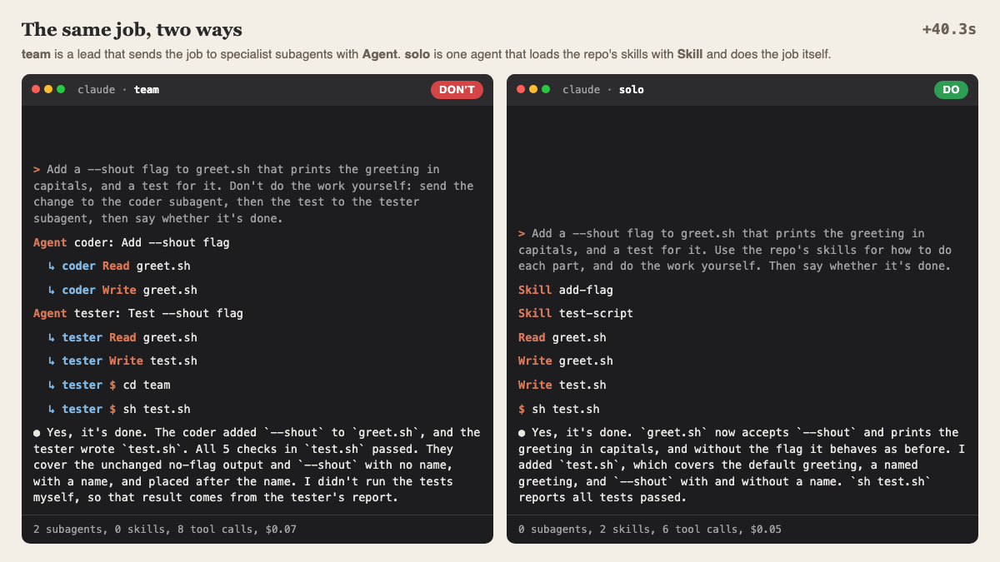

import ArmyVsSkillsPlayground from '@site/src/components/ArmyVsSkills';

## The urge

If you use Claude Code and are thinking about setting up a team of agents for the first time, this
page is for you.

At some point in your AI adoption journey, you've probably had the idea to set up a team of
specialist agents: a coder, a tester, a reviewer, each with its own instructions. My tip: resist
the urge. Instead, build a set of Claude skills in your repo that don't overlap. Then, if you want
to parallelize the work, tell Claude to spawn subagents that use those skills.

A team of agents may build things for you with little guidance, but at a cost, primarily:

- **Money.** Every subagent reads the repo again for itself.
- **Time.** A team generally takes longer: the lead waits on each helper, and each helper starts
  from scratch.
- **Curiosity.** The work happens out of sight, so you get fewer chances to ask why it went this
  way and not that way.
- **Understanding.** You'll have even less of an idea of the decisions Claude is making on your
  behalf.

The first two costs I could measure, so I did.

## The experiment

I gave Claude Code the same know-how two ways:

1. **One agent with skills.** A coder, a tester and a reviewer text, installed as skills. One agent
   does the work and loads a text when it wants it.
2. **A lead with subagents.** The same three texts, installed as subagents. A lead hands the work
   out to them.

Everything else was the same: Opus 5.5 at medium effort for every agent, the same copy of my blog's
repo, and the same two tasks.

- **Task A** splits into parts: a comparison-table component, its styles, a docs page and tests.
- **Task B** goes step by step: parse a run log, then draw a timeline from it.

Each setup ran each task 3 times, 12 runs in all. Every run was checked by tests it never saw, and
by a reviewer that saw only the diff and didn't know which setup wrote it.

## What it cost

| | One agent + skills | Lead + subagents |
|---|--:|--:|
| Cost per run | $0.60 | $1.92 |
| Minutes per run | 2.5 | 6.5 |
| Output tokens per run | about 11k | about 46k |
| Lines of code added | 292 to 449 | 583 to 762 |
| Hidden tests passed | 6 of 6 runs | 5 of 6 runs |

The team cost 3.2 times as much and took 2.6 times as long. The cost gap held in all 6 pairs of
runs, on both tasks.

I expected the team to win back some time on task A, the one that splits into parts. It didn't.
The lead handed work to one helper at a time, every run: coder, tester, reviewer, coder again,
tester again. Nothing ran at once.

## Where the money went

Each subagent reads the repo again for itself. In the team runs, 54 to 72 percent of everything
read went to the subagents, not the lead. The team also thought about five times as much and wrote
about twice the code.

Most of that work is out of sight, too. In one team run, Claude wrote 49 messages, and 34 of them
came from subagents. In your terminal, each subagent shows up as a single "Done" line, so you never
read those 34. The one-agent run wrote 12 messages, and all 12 were in front of you.

## Was the work better?

Scored one at a time, the two came out about even: 4.2 to 4.4 out of 5 for both. The reviewer said
the team's code read better and was tested more, and that it built things nobody asked for.

Side by side, it was split. On the table task, the reviewer ranked the team's three versions first.
On the timeline task, a skills version came first and a team version came last.

The one failed run is a judgment call. The team added screen-reader text, "Not available", next to
a dash in an empty cell, and the hidden test wanted the dash alone. I counted it as a fail, as I
said I would before the runs.

## Pros and cons

| | One agent + skills | Lead + specialist subagents |
|---|---|---|
| **Pros** | About a third of the price. Faster. Every step happens in the session you're watching, so you can stop it and ask why. | Needs less guidance from you. The reviewer found its code read better and was tested more. Each specialist keeps its own narrow tools. |
| **Cons** | One agent's context fills with everything it reads. | 3.2 times the cost and 2.6 times as long here. Wrote twice the code, some of it unasked for. Ran one helper at a time, so no speed-up. You see the lead's summary, not the work. |
| **Pick it when** | The job is a side job in the middle of your own work, and you want to follow along. | You'll run this exact job again and again, on batches, and its tools should stay narrow. |

## See it for yourself

Here is a much smaller run of the same idea: one job, add a `--shout` flag to a script and test it.
On the left, a lead sends it to a coder and a tester subagent. On the right, one agent loads two
skills and does it itself.

Both finished and both tests passed. Look at the lead's last line: "I didn't run the tests myself,
so that result comes from the tester's report." That's the understanding cost, in its own words.

## Play with what they built

Task B asked both setups for the same thing: a `RunTimeline` component that draws how one run of
an AI coding session went over time. Below are two of the real results, one from each setup, copied
in as they wrote them. Both draw the same log, and you can edit it to see how each one copes.

<ArmyVsSkillsPlayground />

The team's version cost $1.86 and took 7.8 minutes. The skills version cost $0.56 and took 2.4
minutes. Both passed all 8 hidden tests.

## What I take from it

- For work like this, a single agent with skills does the job for about a third of the price.
- A team of subagents doesn't run in parallel unless you make it. Mine ran in a line.
- Three runs a side and one reviewer can't settle quality. The team's better tables are a lead for
  a bigger test, not a verdict.

Keep an eye out for a future post on when I actually craft an agent instead of adding another
skill.

Have you created your team of agents? Do you still use it today?
